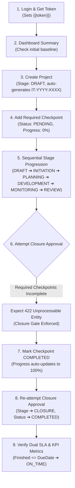

# IT Project & KPI Management — Bruno API Testing & Integration Guide

This guide describes how to connect to and test the headless **IT Project & KPI Management REST API** in **DISS** using [Bruno](https://www.usebruno.com/) (an open-source, Git-friendly API client).

A complete, pre-configured Bruno collection is located directly inside this repository at:
```text
docs/modules/it-project-management/bruno/
```

---

## 1. Quick Start: Opening the Collection in Bruno

1. **Install Bruno**: Download and install Bruno from [usebruno.com](https://www.usebruno.com/) (available for Windows, macOS, and Linux).
2. **Open Collection**:
   - In Bruno, click **Open Collection**.
   - Navigate to your cloned repository:
     ```text
     <repo-root>/docs/modules/it-project-management/bruno
     ```
   - Click **Open**. The collection **"DISS IT Project & KPI Management"** will appear in the left sidebar.
3. **Select Environment & Configure Credentials**:
   - In the top-right environment selector, choose **`Local`**.
   - Click the **Configure** (gear icon) on the `Local` environment.
   - Enter your developer account credentials in **`email`** and **`password`**.
   - *(Note: `email`, `password`, and `token` are declared under `vars:secret`, meaning Bruno saves them in your local machine's secret storage and never writes plaintext passwords to Git!)*
4. **Run Requests**: You can now select any request and click **Send**.

---

## 2. Environment Variables & Git Cleanliness

The collection is designed to keep Git diffs 100% clean across developers:

### A. Environment File (`Local.bru`)
Contains only non-sensitive hosts and variable placeholders:
* `baseUrl`: `http://localhost`
* `email`: *[User-defined secret in Bruno GUI]*
* `password`: *[User-defined secret in Bruno GUI]*


### B. Dynamic Variables (`bru.setVar` + `bru.setEnvVar`)
Dynamic runtime IDs and security tokens generated during execution are bound to both runtime session memory and the active environment:

| Variable | Description | Set Automatically By | Scope |
| :--- | :--- | :--- | :--- |
| `token` | Sanctum Bearer token | `00-Auth/01. Login` | Dual (`setVar` + `setEnvVar`) |
| `picId` | Authenticated PIC User ID | `00-Auth/01. Login` / `02. Me` | Dual (`setVar` + `setEnvVar`) |
| `departmentId` | Authenticated Department ID | `00-Auth/01. Login` / `02. Me` | Dual (`setVar` + `setEnvVar`) |
| `projectId` | Active Project UUID | `02-Projects/01. List` / `02. Create` | Dual (`setVar` + `setEnvVar`) |
| `checkpointId`| Active Checkpoint UUID | `03-Checkpoints/01. List` / `02. Create` | Dual (`setVar` + `setEnvVar`) |
| `attachmentId`| Uploaded Evidence UUID | `03-Checkpoints/04. Upload Evidence` | Dual (`setVar` + `setEnvVar`) |


### How Token Injection Works
All requests automatically receive the Bearer token via `collection.bru`:
```bru
headers {
  Accept: application/json
  Authorization: Bearer {{token}}
}

script:pre-request {
  const token = bru.getEnvVar("token") || bru.getVar("token");
  const url = req.getUrl ? req.getUrl() : "";
  if (token && !url.includes("/auth/login")) {
    req.setHeader("Authorization", `Bearer ${token}`);
  }
}
```
You only need to run **`00-Auth/01. Login & Get Token`** once. Bruno stores the token in the session and environment, and dynamically injects `Authorization: Bearer <token>` into all subsequent requests.

---


## 3. Recommended QA Testing Sequence

Follow this end-to-end workflow to verify all domain invariants and state machine rules:



---

## 4. Endpoints Reference & Request Payloads

### Folder: `00-Auth`

#### `01. Login & Get Token`
* **Method**: `POST`
* **URL**: `{{baseUrl}}/api/v1/auth/login`
* **Body**:
  ```json
  {
    "email": "{{email}}",
    "password": "{{password}}",
    "device_name": "bruno-client"
  }
  ```
* **Post-Response Script**:
  ```javascript
  if (res.body && res.body.data && res.body.data.token) {
    bru.setVar("token", res.body.data.token);
    bru.setEnvVar("token", res.body.data.token);
  }
  ```

#### `02. Get Authenticated User Profile`
* **Method**: `GET`
* **URL**: `{{baseUrl}}/api/v1/auth/me`
* Verifies Bearer authentication and retrieves the authenticated user's department and role.

#### `03. Logout & Invalidate Token`
* **Method**: `POST`
* **URL**: `{{baseUrl}}/api/v1/auth/logout`
* Revokes the current access token on the Sanctum backend.
* **Important**: Run this only when you are done testing, or be prepared to re-run `01. Login` to obtain a new token.

---

### Folder: `01-Dashboard`

Pre-aggregated dashboard metrics for mobile client views:
* `GET {{baseUrl}}/api/v1/projects/dashboard/summary` — Project totals, health breakdown (`on_track`, `at_risk`, `overdue`), Dual SLA rates (`original_sla_rate`, `revised_schedule_rate`), and cancellation rate.
* `GET {{baseUrl}}/api/v1/projects/dashboard/stage-distribution` — Project counts per lifecycle stage.
* `GET {{baseUrl}}/api/v1/projects/dashboard/pic-leaderboard` — PIC delivery metrics and on-time percentages.
* `GET {{baseUrl}}/api/v1/projects/dashboard/upcoming-deadlines?days=30` — Active projects approaching deadline within window (default: 30 days, configurable via `?days=7, 14, 30`). Returns array of `ProjectResource` objects sorted by `due_date` ascending.

---

### Folder: `02-Projects`

#### `01. List Projects`
* **Method**: `GET`
* **URL**: `{{baseUrl}}/api/v1/projects?page=1&per_page=15`
* **Query Filters**: `stage`, `status`, `department_id`, `pic_id`, `priority`, `search`.

#### `02. Create Project`
* **Method**: `POST`
* **URL**: `{{baseUrl}}/api/v1/projects`
* **Body**:
  ```json
  {
    "name": "MES Machine Telemetry v2",
    "description": "Integration of factory floor PLC machines to DISS real-time telemetry dashboard.",
    "requester_name": "Pak Budi",
    "requester_department_id": 1,
    "primary_pic_id": 1,
    "priority": "HIGH",
    "start_date": "2026-10-15",
    "due_date": "2026-12-31"
  }
  ```
* **Post-Response Script**:
  ```javascript
  bru.setEnvVar("projectId", res.body.data.id);
  ```

#### `03. Get Project Detail (Composite)`
* **Method**: `GET`
* **URL**: `{{baseUrl}}/api/v1/projects/{{projectId}}`
* Returns full composite payload: Core metadata, PIC, department, checkpoints, attachments, extensions, stage histories, and real-time health rating (`ON_TRACK`, `AT_RISK`, `OVERDUE`).

---

### Folder: `03-Checkpoints`

#### `02. Create Checkpoint`
* **Method**: `POST`
* **URL**: `{{baseUrl}}/api/v1/projects/{{projectId}}/checkpoints`
* **Body**:
  ```json
  {
    "title": "Architecture & Network Diagram Sign-Off",
    "description": "Approval from IT Infrastructure team on machine gateway subnet allocation.",
    "sequence_order": 1,
    "is_required": true,
    "due_date": "2026-11-15",
    "notes": "Gate requirement for development rollout."
  }
  ```
* **Post-Response Script**:
  ```javascript
  bru.setEnvVar("checkpointId", res.body.data.id);
  ```

#### `03. Mark Checkpoint Completed`
* **Method**: `POST`
* **URL**: `{{baseUrl}}/api/v1/checkpoints/{{checkpointId}}/complete`
* Automatically sets `status = COMPLETED`, timestamps `completed_date`, and triggers `ProjectCheckpointObserver` to recalculate `progress_percent`.

#### `04. Upload Evidence Attachment`
* **Method**: `POST`
* **URL**: `{{baseUrl}}/api/v1/checkpoints/{{checkpointId}}/attachments`
* **Body**: Multipart Form (`file: @file(...)`, max 15MB, allowed formats: `jpg, jpeg, png, pdf, docx, xlsx, zip`).
* **Post-Response Script**:
  ```javascript
  bru.setEnvVar("attachmentId", res.body.data.id);
  ```

#### `05. Download Evidence Stream`
* **Method**: `GET`
* **URL**: `{{baseUrl}}/api/v1/checkpoints/attachments/{{attachmentId}}/download`
* Authenticated stream response with `X-Content-Type-Options: nosniff`.

---

### Folder: `04-Workflow`

#### `01. Transition Stage`
* **Method**: `POST`
* **URL**: `{{baseUrl}}/api/v1/projects/{{projectId}}/transition-stage`
* **Normal Progression**:
  ```json
  {
    "target_stage": "INITIATION",
    "is_override": false,
    "reason": null
  }
  ```
* **Out-of-Order Override**:
  ```json
  {
    "target_stage": "DEVELOPMENT",
    "is_override": true,
    "reason": "Expedited fast-track approved by IT Head."
  }
  ```

#### `02. Hold Project`
* **Method**: `POST`
* **URL**: `{{baseUrl}}/api/v1/projects/{{projectId}}/hold`
* **Body**:
  ```json
  {
    "reason": "Awaiting PLC spare part shipment from vendor overseas."
  }
  ```

#### `03. Resume Project`
* **Method**: `POST`
* **URL**: `{{baseUrl}}/api/v1/projects/{{projectId}}/resume`
* **Body**:
  ```json
  {
    "extend_due_date": true
  }
  ```
  *(If `extend_due_date = true`, calculates paused duration $\Delta t$, extends `due_date`, and records an audit extension under `PAUSE_EXTENSION`).*

#### `04. Approve Closure`
* **Method**: `POST`
* **URL**: `{{baseUrl}}/api/v1/projects/{{projectId}}/approve-closure`
* **Body**:
  ```json
  {
    "comments": "All deliverables and machine telemetry integration verified."
  }
  ```
  *Note: Will return `422 Unprocessable Entity` if any required checkpoint is not completed.*

#### `06. Cancel Project`
* **Method**: `POST`
* **URL**: `{{baseUrl}}/api/v1/projects/{{projectId}}/cancel`
* **Body**:
  ```json
  {
    "reason_category": "REQUESTER_DEPEN_DEP_PRIORITIZED",
    "notes": "Requester department postponed automation to next fiscal year."
  }
  ```
  *Categories: `REQUESTER_DEPEN_DEP_PRIORITIZED`, `BUDGET_CUT`, `TECHNICAL_INFEASIBILITY`, `DUPLICATE`, `OTHER`.*

---

### Folder: `05-Extensions`

#### `02. Request Deadline Extension`
* **Method**: `POST`
* **URL**: `{{baseUrl}}/api/v1/projects/{{projectId}}/extensions`
* **Body**:
  ```json
  {
    "new_due_date": "2027-01-31",
    "reason_category": "SCOPE_CHANGE",
    "reason_details": "Added 2 additional assembly lines to telemetry monitoring pipeline."
  }
  ```
  *Categories: `SCOPE_CHANGE`, `VENDOR_DELAY`, `MANAGEMENT_PREEMPTION`, `PAUSE_EXTENSION`, `OTHER`.*

---

## 5. Writing Automated Assertions in Bruno

In Bruno, each request has a **Tests** tab. Engineers can write Chai-style assertions to automate test execution:

```javascript
test("HTTP Status is 200 OK", function() {
  expect(res.getStatus()).to.equal(200);
});

test("Response envelope is successful", function() {
  expect(res.body.success).to.be.true;
  expect(res.body.data).to.be.an('object');
});

test("Project Code matches format", function() {
  expect(res.body.data.project_code).to.match(/^IT-\d{4}-\d{4}$/);
});

test("Progress percent is computed as number", function() {
  expect(res.body.data.progress_percent).to.be.a('number');
});
```

> **Note on Response Envelopes**:
> - **Mutations & Detail Endpoints** (`POST`, `PUT`, `GET /projects/{id}`, `GET /dashboard/*`): Return wrapped JSON with `{ "success": true, "data": { ... }, "message": "..." }`.
> - **Paginated & List Endpoints** (`GET /projects`, `/checkpoints`, `/extensions`): Return Laravel's standard `ResourceCollection` structure with `{ "data": [ ... ], "meta": { ... }, "links": { ... } }`.

To run the entire collection automatically:
1. Click the **Runner** button at the top of the collection sidebar in Bruno.
2. Select **Run Collection**.
3. Bruno will execute all requests in sequence and output a test pass/fail report.

---

## 6. Troubleshooting Common Issues

| Status Code | Cause | Solution |
| :--- | :--- | :--- |
| **`401 Unauthenticated`** | Missing or expired Sanctum Bearer token. | Run `00-Auth/01. Login & Get Token` first to refresh `{{token}}`. |
| **`422 Unprocessable Entity`** | Validation failure or Domain rule violation. | Check the response body `errors` map. If attempting closure, ensure all checkpoints with `is_required = true` are `COMPLETED`. |
| **`404 Not Found`** | `{{projectId}}` or `{{checkpointId}}` is invalid or deleted. | Ensure you ran `Create Project` or verify the UUID in the active environment. |
| **Connection Refused** | Laravel Sail or web server is not running. | Run `./vendor/bin/sail up -d` in the project root. |
